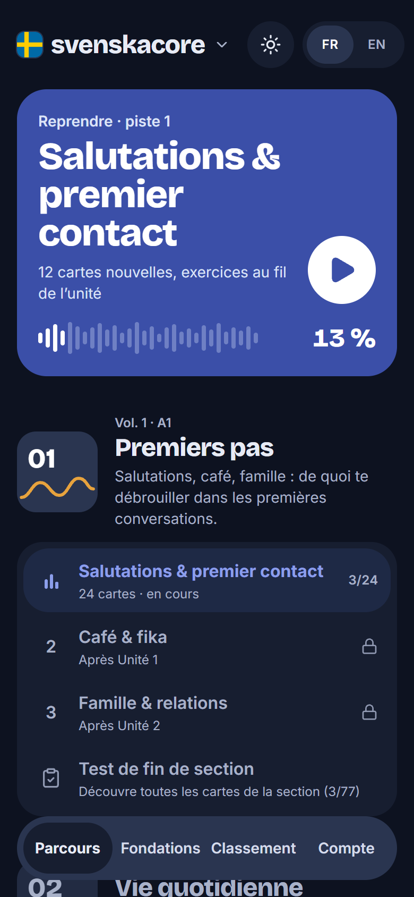
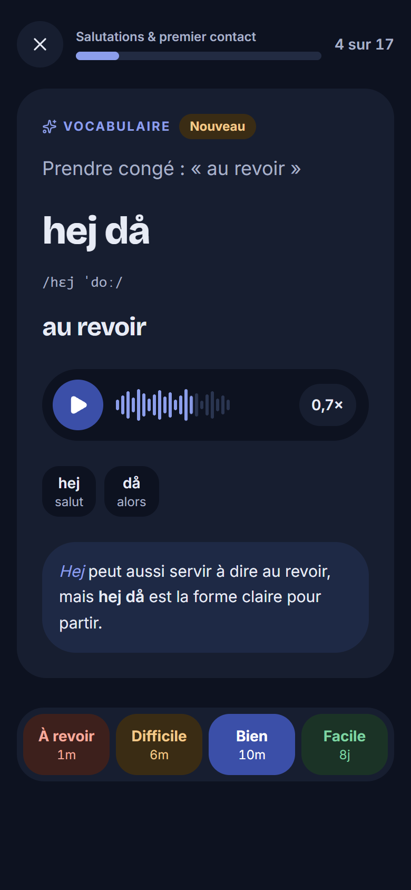
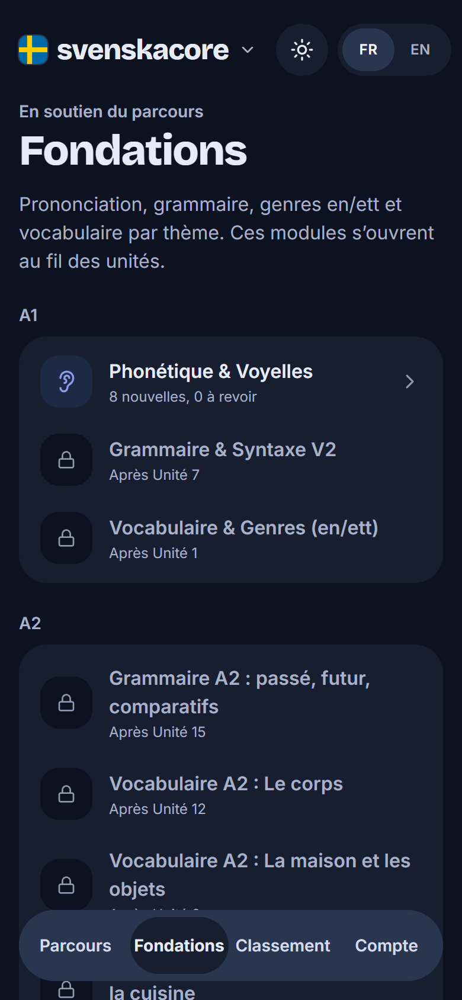
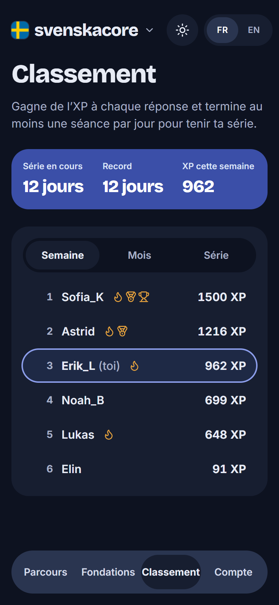

# SvenskaCore

[English version](README.md)

Une app d'apprentissage des langues avec deux cours :
- **SvenskaCore** : le suédois pour francophones et anglophones, de A1 à B2.
- **FranceCore** : le français pour suédophones et anglophones, de A1 à B2.

Des cartes audio avec répétition espacée (FSRS), un parcours en sections et unités avec exercices, des tests de section et un compte facultatif pour la synchro, la série de jours et le classement. L'app marche hors ligne, sur le web, sur iPhone (app web installée) et sur Android (APK).

**L'essayer : [svenska-core.pages.dev](https://svenska-core.pages.dev)**

<p>
  
  
  
  
</p>

## Contenu

- 2 cours, chacun en 8 sections et 31 unités, de A1 à B2 (programmes : [suédois](docs/PROGRAMME.md), [français](docs/PROGRAMME-FR.md), en anglais).
- Environ 3 000 mots et expressions suédois distincts, dont 44 decks de vocabulaire par thème.
- Chaque carte a son audio en voix native (normal et lent), sa prononciation IPA, sa traduction, une glose mot à mot pour les phrases et une courte note. Les mots suédois affichent la courbe de leur accent tonal.
- Séances d'unité : des blocs de 6 nouvelles cartes, puis des exercices sur ces cartes (associer les paires, QCM, écoute, phrase à reconstruire, écriture, dictée), puis des rappels des mots déjà vus.
- Répétition espacée avec FSRS : chaque carte revient juste avant que tu l'oublies.
- Interface en français ou en anglais (et en suédois pour FranceCore), thème clair et sombre.

## Utiliser l'app

### L'installer

| Appareil | Comment |
|---|---|
| iPhone | Ouvre [svenska-core.pages.dev](https://svenska-core.pages.dev) dans **Safari**, appuie sur **Partager**, puis sur **Sur l'écran d'accueil**. |
| Android | Ouvre le site dans Chrome et choisis **Installer l'application** dans le menu, ou installe l'APK (voir [Android](#android)). |
| Ordinateur | Ouvre le site dans un navigateur récent. Chrome et Edge peuvent aussi l'installer comme une app. |

Au premier lancement, laisse l'app ouverte une à deux minutes en Wi-Fi : elle télécharge tous les sons, puis marche sans connexion. Les mises à jour s'installent toutes seules ; une nouvelle version s'affiche à l'ouverture suivante.

### Apprendre

1. Onglet **Parcours** : appuie sur **Reprendre** (ou sur une unité) pour lancer une séance. Les unités s'ouvrent l'une après l'autre.
2. Sur une carte, dis la réponse à voix haute, puis retourne la carte et note-toi : **À revoir**, **Difficile**, **Bien** ou **Facile**. Le délai sous chaque bouton indique quand la carte reviendra.
3. Toutes les 6 nouvelles cartes, de courts exercices vérifient ce que tu viens d'apprendre. Tu ne peux pas écouter ? L'exercice propose de passer à des versions sans son pendant une heure.
4. À la fin d'une section, réussis le **test de section** (80 %) pour ouvrir la suivante.
5. Onglet **Fondations** : decks de prononciation, de grammaire et de vocabulaire par thème, chacun débloqué par une unité du parcours.

Raccourcis clavier sur une carte : **Espace** la retourne, **1** à **4** notent, **R** réécoute le son, **S** le joue lentement.

Pour changer de cours (SvenskaCore ou FranceCore), appuie sur le logo en haut. Les boutons **FR / EN** changent la langue de l'interface.

### Compte, classement et rappels (facultatifs)

Sans compte, tout marche et ta progression reste sur l'appareil. Dans l'onglet **Compte**, tu peux :
- créer un compte pour synchroniser ta progression entre appareils ;
- choisir un pseudo pour apparaître dans le **Classement** (XP de la semaine, du mois, série de jours) ;
- activer un **rappel quotidien** à l'heure de ton choix (app Android, ou iPhone avec l'app sur l'écran d'accueil et iOS 16.4 ou plus récent).

Une journée compte dans ta série dès que tu y termines une séance.

## Pour les développeurs

### Stack

- React 19, TypeScript, Vite, Tailwind CSS v4
- `ts-fsrs` pour la répétition espacée
- Supabase : en local (Docker) pour le pipeline de contenu, Cloud pour les comptes, la synchro, le classement et les rappels push
- `edge-tts` pour l'audio (`sv-SE-SofieNeural` en suédois, `fr-FR-DeniseNeural` en français)
- Capacitor pour l'app Android ; un service worker pour l'app web hors ligne

### Organisation

```
content/            source de vérité des cours
  sv/               SvenskaCore (sections.mjs, helpers.mjs, tones.mjs, a1/ a2/ b1/ b2/)
  fr/               FranceCore (sections.mjs, helpers.mjs, index.mjs, a1/ a2/ b1/ b2/)
scripts/
  sync-content.mjs  synchro de la base + génération des MP3 + export de src/content.json (npm run content)
  build-android.mjs build Android adapté à la charge du PC (npm run apk, npm run apk:release)
  sw.js             modèle du service worker (cache hors ligne, rappels push)
  check-*.mjs/.ts   contrôles hors ligne (contenu, plan de séance, synchro, XP, accents tonals)
src/                app React
public/audio/       MP3 générés (versionnés)
supabase/           schema.sql (contenu), cloud-schema.sql (comptes), migrations-manuelles/, functions/
docs/               programmes et captures d'écran
```

### Lancer l'app en local

Il faut Node 22. Le contenu (`src/content.json`) et les sons (`public/audio/`) sont versionnés : aucune base n'est nécessaire pour lancer l'app.

```bash
npm install
npm run dev
```

Sans variables Supabase, l'app marche sans compte (progression sur l'appareil seulement).

### Modifier le contenu

Les fichiers `content/` sont la source de vérité. Après une modification, `npm run content` synchronise la base locale, génère les MP3 manquants et exporte `src/content.json`.

Il faut Docker, le CLI Supabase et Python.

```bash
supabase start                      # Supabase local
# Base neuve : coller supabase/schema.sql dans Studio > SQL Editor (http://127.0.0.1:54323)
python -m pip install edge-tts
npm run content
```

`.env.local` (non versionné) :
```
VITE_SUPABASE_URL=http://127.0.0.1:54321
VITE_SUPABASE_ANON_KEY=<clé anon affichée par `supabase status`>
```

Contrôles :
```bash
npx tsc -b
npm run lint
node scripts/check-fr.mjs                                   # contenu FranceCore
node scripts/check-tones.mjs                                # accents tonals suédois
node scripts/count-vocab.mjs                                # comptage du vocabulaire suédois
node --experimental-strip-types scripts/check-session.ts    # plan de séance
node --experimental-strip-types scripts/check-sync.ts       # fusion de la progression
node --experimental-strip-types scripts/check-xp.ts         # XP et série
```

Conventions du contenu : pas de tiret cadratin ni d'emoji ; titres au format `Unité 1 : Salutations` ; formes multiples séparées par ` / `. Dans le cours de suédois, le champ `english_translation` contient la traduction française (nom historique).

### Comptes (Supabase Cloud)

1. Crée un projet Supabase, puis lance `supabase/cloud-schema.sql` et `supabase/migrations-manuelles/migration_classement.sql` dans son SQL Editor.
2. Mets l'URL du projet et sa clé publique (anon) dans `.env.production` (build web) et `.env.android` (APK) :
   ```
   VITE_SUPABASE_URL=https://<project-ref>.supabase.co
   VITE_SUPABASE_ANON_KEY=<clé publique>
   ```
   Ces clés sont publiques par conception : les données sont protégées par la sécurité au niveau des lignes (RLS). Vides, l'app marche sans compte.

### Rappels quotidiens (push web)

L'app Android utilise des notifications locales, sans serveur. L'app web utilise le push, envoyé par la fonction Supabase `send-reminders` toutes les 5 minutes. Mise en place unique sur le projet Cloud, depuis la racine du dépôt :

```bash
npx supabase login
npx supabase db query --remote=<project-ref> --yes --file supabase/migrations-manuelles/migration_rappels.sql
node scripts/setup-reminders.mjs mailto:toi@exemple.fr --yes
npx supabase db query --remote=<project-ref> --yes --file supabase/rappels-cron.sql.local
```

`setup-reminders.mjs` génère les clés VAPID et le secret d'appel, les enregistre comme secrets de la fonction, écrit la clé publique dans `.env.production`, déploie la fonction et écrit le SQL de planification dans `supabase/rappels-cron.sql.local`. Ce fichier contient le secret : supprime-le une fois appliqué. Ne relance pas le script : de nouvelles clés VAPID rendent inutilisables les abonnements existants.

### Déployer l'app web

Cloudflare Pages relié au dépôt GitHub : commande `npm run build`, dossier `dist`, Node 22 (`.node-version`). Chaque push sur `main` redéploie le site.

### Android

Il faut Android Studio (son JDK et le SDK Android sont trouvés automatiquement).

```bash
npm run apk          # APK debug : android/app/build/outputs/apk/debug/app-debug.apk
```

Le script mesure la charge du processeur et la RAM libre et limite Gradle en conséquence : le PC reste utilisable pendant le build.

#### Version Android signée

La clé de signature reste hors du dépôt, dans `~/.svenskacore/`. À créer une seule fois (PowerShell) :

```powershell
New-Item -ItemType Directory -Force "$env:USERPROFILE\.svenskacore"
& "C:\Program Files\Android\Android Studio\jbr\bin\keytool.exe" -genkeypair -v -keystore "$env:USERPROFILE\.svenskacore\svenskacore-release.jks" -alias svenskacore -keyalg RSA -keysize 2048 -validity 10000
notepad "$env:USERPROFILE\.svenskacore\keystore.properties"
```

`keystore.properties` :
```
storeFile=svenskacore-release.jks
storePassword=<mot de passe>
keyAlias=svenskacore
keyPassword=<mot de passe>
```

Sauvegarde tout le dossier `.svenskacore` et son mot de passe hors du PC : sans cette clé, plus aucune mise à jour de l'app ne pourra être publiée sur le Play Store.

```bash
npm run apk:release
```

Produit `android/app/build/outputs/bundle/release/app-release.aab` (pour le Play Store) et `android/app/build/outputs/apk/release/app-release.apk` (installation directe). Augmente `versionCode` et `versionName` dans `android/app/build.gradle` à chaque publication.

## Crédits

Audio généré avec les voix neuronales de Microsoft via [edge-tts](https://github.com/rany2/edge-tts).
