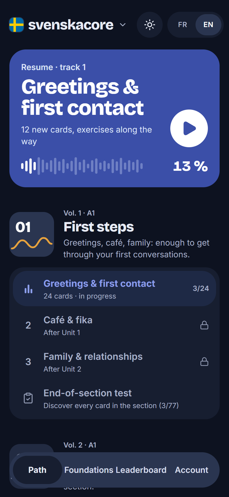
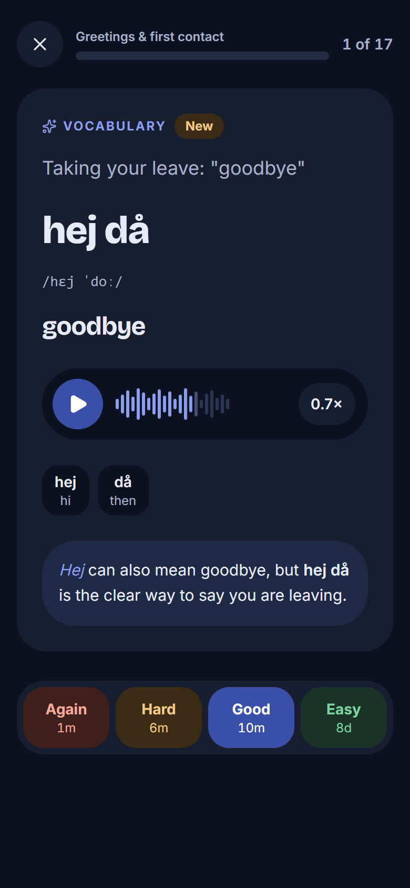
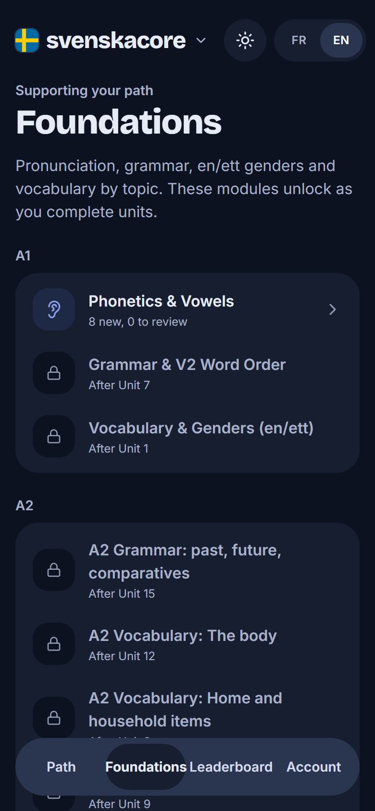
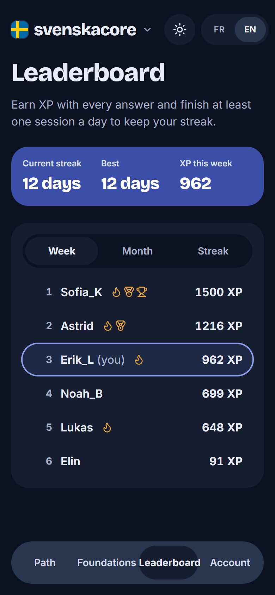

# SvenskaCore

[Version française](README.fr.md)

A language learning app with two courses:
- **SvenskaCore**: Swedish for French and English speakers, A1 to B2.
- **FranceCore**: French for Swedish and English speakers, A1 to B2.

Audio flashcards with spaced repetition (FSRS), a path of sections and units with exercises, section tests, and an optional account for sync, streaks and a leaderboard. It works offline, on the web, on iPhone (as an installed web app) and on Android (APK).

**Try it: [svenska-core.pages.dev](https://svenska-core.pages.dev)**

<p>
  
  
  
  
</p>

## What is inside

- 2 courses, 8 sections and 31 units each, from A1 to B2 (syllabi: [Swedish](docs/PROGRAMME.md), [French](docs/PROGRAMME-FR.md)).
- About 3,000 distinct Swedish words and expressions, including 44 thematic vocabulary decks.
- Every card has native-voice audio (normal and slow), IPA, a translation, a word-by-word gloss for sentences and a short note. Swedish words show their tonal accent curve.
- Unit sessions: blocks of 6 new cards, then exercises on them (match the pairs, multiple choice, listening, rebuild the sentence, writing, dictation), then reviews of words already seen.
- Spaced repetition with FSRS: each card comes back right before you would forget it.
- Interface in French or English (and Swedish for FranceCore), light and dark theme.

## Using the app

### Install it

| Device | How |
|---|---|
| iPhone | Open [svenska-core.pages.dev](https://svenska-core.pages.dev) in **Safari**, tap **Share**, then **Add to Home Screen**. |
| Android | Open the site in Chrome and choose **Install app** in the menu, or install the APK (see [Android](#android)). |
| Computer | Open the site in any recent browser. Chrome and Edge can also install it as an app. |

On first launch, leave the app open for a minute or two on Wi-Fi: it downloads all the sounds and then works without a connection. Updates install themselves; a new version shows on the next launch.

### Learn

1. **Path** tab: tap **Resume** (or a unit) to start a session. Units open one after the other.
2. On a card, say the answer out loud, then flip the card and grade yourself: **Again**, **Hard**, **Good** or **Easy**. The time under each button is when the card will come back.
3. After every 6 new cards, short exercises check what you just learned. Can't listen right now? The exercise offers to switch to versions without sound for an hour.
4. At the end of a section, pass the **section test** (80 %) to open the next section.
5. **Foundations** tab: pronunciation, grammar and thematic vocabulary decks, each unlocked by a unit of the path.

Keyboard shortcuts on a study card: **Space** flips, **1** to **4** grade, **R** replays the sound, **S** plays it slowly.

To switch course (SvenskaCore or FranceCore), tap the logo at the top. The **FR / EN** buttons change the interface language.

### Account, leaderboard and reminders (optional)

Without an account, everything works and your progress stays on the device. In the **Account** tab you can:
- create an account to sync your progress between devices;
- choose a username to appear on the **Leaderboard** (weekly XP, monthly XP, streak);
- turn on a **daily reminder** at the time of your choice (Android app, or iPhone with the app added to the Home Screen and iOS 16.4 or later).

A day counts toward your streak as soon as you finish a session that day.

## For developers

### Stack

- React 19, TypeScript, Vite, Tailwind CSS v4
- `ts-fsrs` for spaced repetition
- Supabase: local (Docker) for the content pipeline, Cloud for accounts, sync, leaderboard and push reminders
- `edge-tts` for the audio (`sv-SE-SofieNeural` for Swedish, `fr-FR-DeniseNeural` for French)
- Capacitor for the Android app; a service worker for the offline web app

### Project layout

```
content/            source of truth of the courses
  sv/               SvenskaCore (sections.mjs, helpers.mjs, tones.mjs, a1/ a2/ b1/ b2/)
  fr/               FranceCore (sections.mjs, helpers.mjs, index.mjs, a1/ a2/ b1/ b2/)
scripts/
  sync-content.mjs  database sync + MP3 generation + export of src/content.json (npm run content)
  build-android.mjs Android build adapted to the PC load (npm run apk, npm run apk:release)
  sw.js             service worker template (offline cache, push reminders)
  check-*.mjs/.ts   offline checks (content, session plan, sync, XP, tonal accents)
src/                React app
public/audio/       generated MP3 files (committed)
supabase/           schema.sql (content), cloud-schema.sql (accounts), migrations-manuelles/, functions/
docs/               syllabi and screenshots
```

### Run the app locally

Requires Node 22. The content (`src/content.json`) and the sounds (`public/audio/`) are committed, so no database is needed to run the app:

```bash
npm install
npm run dev
```

Without Supabase variables, the app runs without accounts (progress on the device only).

### Edit the content

The `content/` files are the source of truth. After a change, `npm run content` syncs the local database, generates the missing MP3 files and exports `src/content.json`.

Requires Docker, the Supabase CLI and Python.

```bash
supabase start                      # local Supabase
# New database: paste supabase/schema.sql into Studio > SQL Editor (http://127.0.0.1:54323)
python -m pip install edge-tts
npm run content
```

`.env.local` (not committed):
```
VITE_SUPABASE_URL=http://127.0.0.1:54321
VITE_SUPABASE_ANON_KEY=<anon key shown by `supabase status`>
```

Checks:
```bash
npx tsc -b
npm run lint
node scripts/check-fr.mjs                                   # FranceCore content
node scripts/check-tones.mjs                                # Swedish tonal accents
node scripts/count-vocab.mjs                                # Swedish vocabulary count
node --experimental-strip-types scripts/check-session.ts    # session plan
node --experimental-strip-types scripts/check-sync.ts       # progress merge
node --experimental-strip-types scripts/check-xp.ts         # XP and streak
```

Content conventions: no em dash and no emoji; titles like `Unité 1 : Salutations`; multiple forms separated by ` / `. In the Swedish course, the `english_translation` field holds the French translation (historical name).

### Accounts (Supabase Cloud)

1. Create a Supabase project, then run `supabase/cloud-schema.sql` and `supabase/migrations-manuelles/migration_classement.sql` in its SQL Editor.
2. Put the project URL and its publishable (anon) key in `.env.production` (web build) and `.env.android` (APK):
   ```
   VITE_SUPABASE_URL=https://<project-ref>.supabase.co
   VITE_SUPABASE_ANON_KEY=<publishable key>
   ```
   These keys are public by design: the data is protected by row level security (RLS). Left empty, the app runs without accounts.

### Daily reminders (web push)

The Android app uses local notifications and needs no server. The web app uses push, sent by the `send-reminders` Supabase function every 5 minutes. One-time setup on the Cloud project, from the repository root:

```bash
npx supabase login
npx supabase db query --remote=<project-ref> --yes --file supabase/migrations-manuelles/migration_rappels.sql
node scripts/setup-reminders.mjs mailto:you@example.com --yes
npx supabase db query --remote=<project-ref> --yes --file supabase/rappels-cron.sql.local
```

`setup-reminders.mjs` generates the VAPID keys and the call secret, stores them as function secrets, writes the public key into `.env.production`, deploys the function and writes the scheduling SQL to `supabase/rappels-cron.sql.local`. That file contains the secret: delete it once applied. Do not run the script again: new VAPID keys break the existing subscriptions.

### Deploy the web app

Cloudflare Pages connected to the GitHub repository: build command `npm run build`, output folder `dist`, Node 22 (`.node-version`). Every push to `main` redeploys the site.

### Android

Requires Android Studio (its JDK and Android SDK are found automatically).

```bash
npm run apk          # debug APK: android/app/build/outputs/apk/debug/app-debug.apk
```

The script measures the CPU load and free RAM and limits Gradle accordingly, so the PC stays usable during the build.

#### Signed Android release

The signing key stays outside the repository, in `~/.svenskacore/`. Create it once (PowerShell):

```powershell
New-Item -ItemType Directory -Force "$env:USERPROFILE\.svenskacore"
& "C:\Program Files\Android\Android Studio\jbr\bin\keytool.exe" -genkeypair -v -keystore "$env:USERPROFILE\.svenskacore\svenskacore-release.jks" -alias svenskacore -keyalg RSA -keysize 2048 -validity 10000
notepad "$env:USERPROFILE\.svenskacore\keystore.properties"
```

`keystore.properties`:
```
storeFile=svenskacore-release.jks
storePassword=<password>
keyAlias=svenskacore
keyPassword=<password>
```

Back up the whole `.svenskacore` folder and its password outside the PC: without this key, no update of the app can ever be published on the Play Store again.

```bash
npm run apk:release
```

Outputs `android/app/build/outputs/bundle/release/app-release.aab` (for the Play Store) and `android/app/build/outputs/apk/release/app-release.apk` (direct install). Increase `versionCode` and `versionName` in `android/app/build.gradle` for every release.

## Credits

Audio generated with Microsoft neural voices through [edge-tts](https://github.com/rany2/edge-tts).
